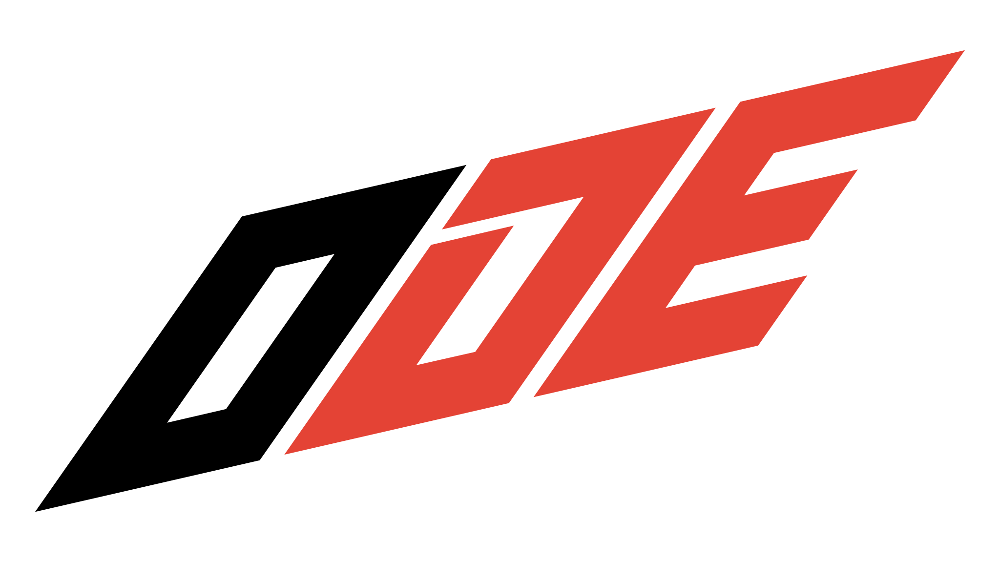
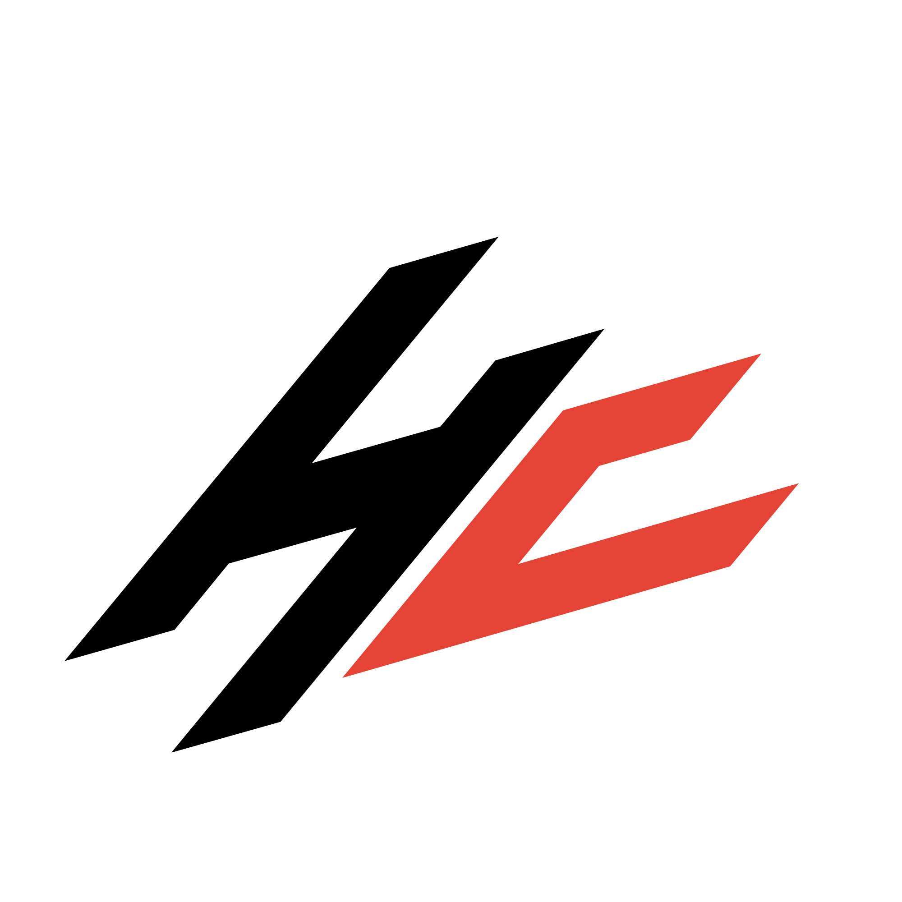

<picture>
  <source media="(prefers-color-scheme: dark)" srcset="assets/brand/ode-white.svg">
  
</picture>

# Open Detection Engineering™

**Deep, practitioner-maintained Detection Engineering education. Open to everyone.**

Open Detection Engineering (ODE) is a community-maintained, openly licensed curriculum for learning Detection Engineering.

> [!IMPORTANT]
> ODE is actively looking for practitioners to review, contribute to, and help shape the curriculum.
> See [CONTRIBUTING.md](CONTRIBUTING.md) to get involved.

## Principles

- **Knowledge should be open.**
- **Practitioners should maintain the knowledge of their profession.**
- **Depth matters.** We aim to teach topics as deeply and technically as useful.
- **Vendor neutrality matters.** Core curriculum should teach concepts rather than products.
- **Commercial experiences are welcome.** Organizations may build paid labs, instruction, platforms, assessments, mentorship, or other experiences around ODE.
- **Stewardship is transparent.** HardCounter stewards the project, and its role and interests are disclosed (see [Stewardship](#stewardship)).
- **No organization owns the truth.** Where legitimate approaches differ, the curriculum should explain the tradeoffs.

## Curriculum Structure

### Core

The Core curriculum contains vendor-neutral knowledge applicable to Detection Engineering regardless of platform or environment.

### Tracks

Tracks extend the Core curriculum into specific areas.

#### Domain Tracks

- Windows
- Linux
- AWS
- Azure
- GCP
- Identity
- Network
- Additional domains as the community develops them

#### Platform Tracks

- Splunk
- Microsoft Sentinel
- Elastic
- CrowdStrike Falcon
- Additional platforms as contributors develop them

#### Advanced Tracks

- Detection Research
- AI-Assisted Detection Engineering
- Additional advanced topics

### Labs and Datasets

ODE may provide open reference labs, datasets, exercises, and assessments. Organizations are also encouraged to build their own learning experiences around the curriculum.

The curriculum defines **what should be learned**. Individual platforms may compete on **how that learning experience is delivered.**

## Current Status

ODE is in its beginning stage.

Initial curriculum structure and seed material should not be interpreted as settled industry consensus. We actively encourage practitioners to challenge, review, improve, and expand it.

See the [roadmap](ROADMAP.md) for where the project is headed.

## Contributing

Contributions are welcome from Detection Engineers, SOC and IR practitioners, researchers, instructors, vendors, training organizations, and others with relevant experience.

See [CONTRIBUTING.md](CONTRIBUTING.md), the [Style Guide](docs/STYLE-GUIDE.md), and the [Review Process](docs/REVIEW-PROCESS.md). Questions and ideas go in [Discussions](https://github.com/HardCounterIO/ode/discussions). Participation is governed by the [Code of Conduct](CODE_OF_CONDUCT.md).

## Governance

ODE currently uses lightweight governance led by the Project Lead while the contributor community develops.

See [GOVERNANCE.md](GOVERNANCE.md).

## Stewardship

Open Detection Engineering is a [HardCounter](https://hardcounter.io) project. HardCounter LLC stewards ODE: it hosts the repository and holds the ODE name and marks.

HardCounter does not control curriculum content. Technical decisions follow the [Review Process](docs/REVIEW-PROCESS.md), and where legitimate approaches differ, the curriculum presents the tradeoffs instead of excluding an approach. The content is openly licensed for everyone, including commercial use ([LICENSE.md](LICENSE.md)).

HardCounter may offer paid training and other services based on ODE, such as live cohorts. Those offerings follow the same licensing and trademark rules as everyone else's and get no special influence over the curriculum. See [GOVERNANCE.md](GOVERNANCE.md#commercial-organizations).

  <a href="https://hardcounter.io"><picture><source media="(prefers-color-scheme: dark)" srcset="assets/brand/hardcounter-white.svg"></picture></a>

## Supporters

  <a href="https://leveleffect.com"><picture><source media="(prefers-color-scheme: dark)" srcset="assets/logos/level-effect.svg"></picture></a>
  &emsp;&emsp;&emsp;&emsp;
  <a href="https://deathdiaries.com/"><picture><source media="(prefers-color-scheme: dark)" srcset="assets/logos/deth-diaries.svg"></picture></a>

See [SUPPORTERS.md](SUPPORTERS.md).

## Citing ODE

See [CITATION.cff](CITATION.cff), or use "Cite this repository" on GitHub.

## License

Educational content is licensed under CC BY-SA 4.0.

Software and lab tooling are licensed under Apache License 2.0.

See [LICENSE.md](LICENSE.md). Use of the ODE name and marks is covered by [TRADEMARK.md](TRADEMARK.md). Security reports: [SECURITY.md](SECURITY.md).

---

Open Detection Engineering™ and ODE are trademarks of HardCounter LLC. See [TRADEMARK.md](TRADEMARK.md).
